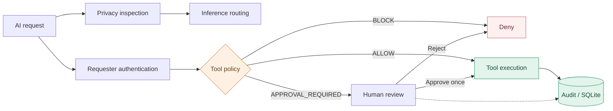

# AgentGate — Enterprise AI Governance

**A privacy-aware AI agent and governance console powered by NVIDIA Nemotron.**

AgentGate is a local enterprise AI security prototype that demonstrates how organizations can inspect AI requests, enforce tool policies, and require human approval before executing sensitive actions.

The system combines policy-based routing, authenticated requester access, reviewer-controlled approvals, persistent audit records, and a real-time governance dashboard.

## Architecture at a glance

AgentGate separates **privacy routing** from **tool authorization**. A request is inspected to determine whether hosted inference is appropriate. Independently, tools enforce requester credentials, customer scope, and a policy decision: **ALLOW**, **BLOCK**, or **APPROVAL_REQUIRED**. Restricted actions can execute only after a reviewer authorizes them; an approval can be consumed once. SQLite preserves review decisions, removal attribution, and sanitized audit metadata.

[**Explore the architecture and implementation evidence →**](docs/ARCHITECTURE_FLOW.md)



**Verified locally:** 153 automated tests passed as of October 2026. The implementation is a localhost-first portfolio prototype with documented security limitations, not a publicly hardened production service.

## Features

- **Privacy-aware routing:** Inspects prompts for sensitive information before deciding whether hosted inference is appropriate.
- **NVIDIA Nemotron integration:** Supports agent reasoning and governed tool interactions.
- **Tool policy enforcement:** Allows, blocks, or requires human approval for tool requests.
- **Requester authentication:** Restricts tool access using API credentials and configured customer scope.
- **Reviewer authentication:** Protects Activity, approval decisions, and audit access.
- **Single-use execution:** Approved actions can be executed only once.
- **Secure record removal:** Requires a separate six-digit deletion code and a reason of 3–100 characters.
- **Persistent governance records:** Uses SQLite to preserve approvals, review decisions, deletion attribution, and sanitized agent audit metadata.
- **Audit preservation:** Removing a request from operational dashboards does not erase its underlying security record.
- **Automated testing:** 153 regression tests passing locally as of October 2026.


## AgentGate Console

AgentGate provides a four-tab web interface:

| Tab | Purpose |
|---|---|
| Route | Inspect requests and demonstrate privacy-aware routing |
| Activity | Authenticate reviewers, manage approvals, and inspect governance activity |
| Gateway | Authenticate requesters, run governed tools, interact with the Nemotron agent, and review execution history |
| Evidence | Explore evaluation results and supporting security evidence |

## Getting Started

Requires Python 3.10 or a compatible newer version.

```bash
python3 -m venv .venv
source .venv/bin/activate
python -m pip install -r requirements.txt
cp .env.example .env
```

Configure your credentials in `.env`, then run:

```bash
python -m unittest discover -s tests -q
python console_server.py
```

Open http://127.0.0.1:8600 in your browser.

The application runs on localhost by default and is not configured for public deployment.

## Configuration

The following environment variables control authentication:

| Variable | Purpose |
|---|---|
| `AGENTGATE_REQUESTER_ID` | Gateway requester identity |
| `AGENTGATE_REQUESTER_API_KEY` | Gateway API credential |
| `AGENTGATE_REQUESTER_CUSTOMERS` | Comma-separated customer IDs accessible to the requester |
| `AGENTGATE_REVIEWER_ID` | Activity reviewer identity |
| `AGENTGATE_REVIEWER_SECRET` | Activity login credential |
| `AGENTGATE_REVIEWER_EMPLOYEE_ID` | Employee ID recorded for removal accountability |
| `AGENTGATE_DELETION_CODE` | Separate six-digit code required to remove resolved approvals |
| `NVIDIA_API_KEY` | Hosted NVIDIA inference credential |

Never commit `.env` or share authentication credentials.

The deletion code is checked server-side with failed-attempt lockout protection. Removed records remain preserved in SQLite for auditing.


## Architecture

AgentGate separates:

1. Privacy inspection and routing
2. NVIDIA model inference
3. Tool policy evaluation
4. Tool execution and human approval
5. Request-level auditing and observability

See [Architecture](docs/ARCHITECTURE.md) and [Product Requirements](docs/PRD.md).


## Security Limitations

AgentGate is a locally hosted portfolio prototype, not a production-certified security platform.

- Sensitive-data detection is pattern-based and may miss information.
- Example customer records and business documents are synthetic.
- Authentication uses locally configured credentials rather than enterprise identity management.
- Reviewer and employee identity are configured for a single-reviewer prototype; multi-user identity attribution is not implemented.
- Some operational dashboard data remains in memory and resets when the server restarts.
- SQLite preserves approval decisions, deletion history, and sanitized agent audit records.
- Tool execution is policy-controlled but not isolated by an operating-system sandbox.
- Hosted NVIDIA inference is an external service and must not receive protected information.
- Synthetic evaluation accuracy does not establish real-world security guarantees.

## Testing

Run the complete automated suite:

```bash
python -m unittest discover -s tests -q
```

For optional responsive browser checks:

```bash
python -m pip install playwright
python -m playwright install chromium
python tools/responsive_check.py
```

## Documentation

- [Architecture](docs/ARCHITECTURE.md)
- [Product Requirements](docs/PRD.md)


## Current Direction

AgentGate demonstrates privacy-aware routing, governed agent actions, human oversight, and explainable AI operations. Future development includes stronger authorization, adversarial evaluation, persistent governance logs, and richer operational analytics.
