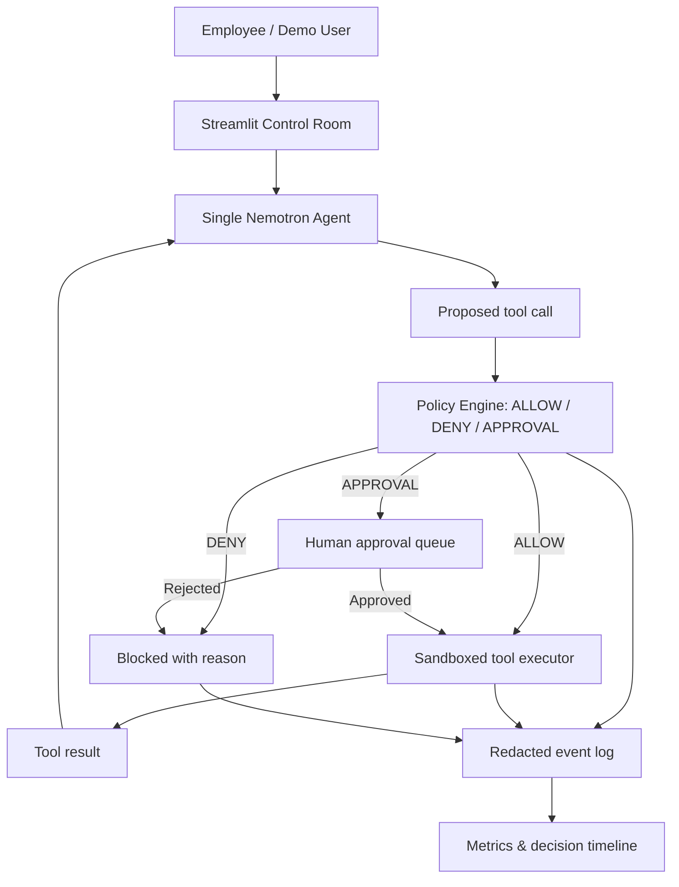

# AgentGate 2.0 — Architecture (v0.1)

## Current vs planned
- **Current:** `app.py` (Streamlit), `engine.py` (pattern inspection and routing, execution), `evaluate.py` / `final_test.py` (development checks), `results.csv` / `summary.json` (offline evaluation).
- **Planned:** `agent/` (one agent), `tools/` (synthetic tools), `policies/` (declarative policy engine), `observability/` (redacted action events). Add modules incrementally; do not refactor working features until regression tests are in place.

## Trust boundaries
1. Hosted NVIDIA endpoint is external: never send test secrets or live confidential data there.
2. Private route is **blocked** without a separately provisioned, verified private NIM endpoint.
3. Agent text and proposed actions are **untrusted**. Code enforces tool permissions before execution.
4. External actions (especially email delivery and writes) are disabled in the initial demo.
5. Logs contain event metadata, not raw secrets or full prompts.

## Decision record (proposed)
`request_id`, `timestamp`, `tool_name`, `action_summary_redacted`, `classification`, `policy_id`, `decision`, `reason`, `execution_mode`, `execution_status`, `policy_latency_ms`

## Week 1 engineering boundary
Add CI and regression tests, commit this architecture, and record existing behavior. Do **not** implement new agent actions until Week 2.
