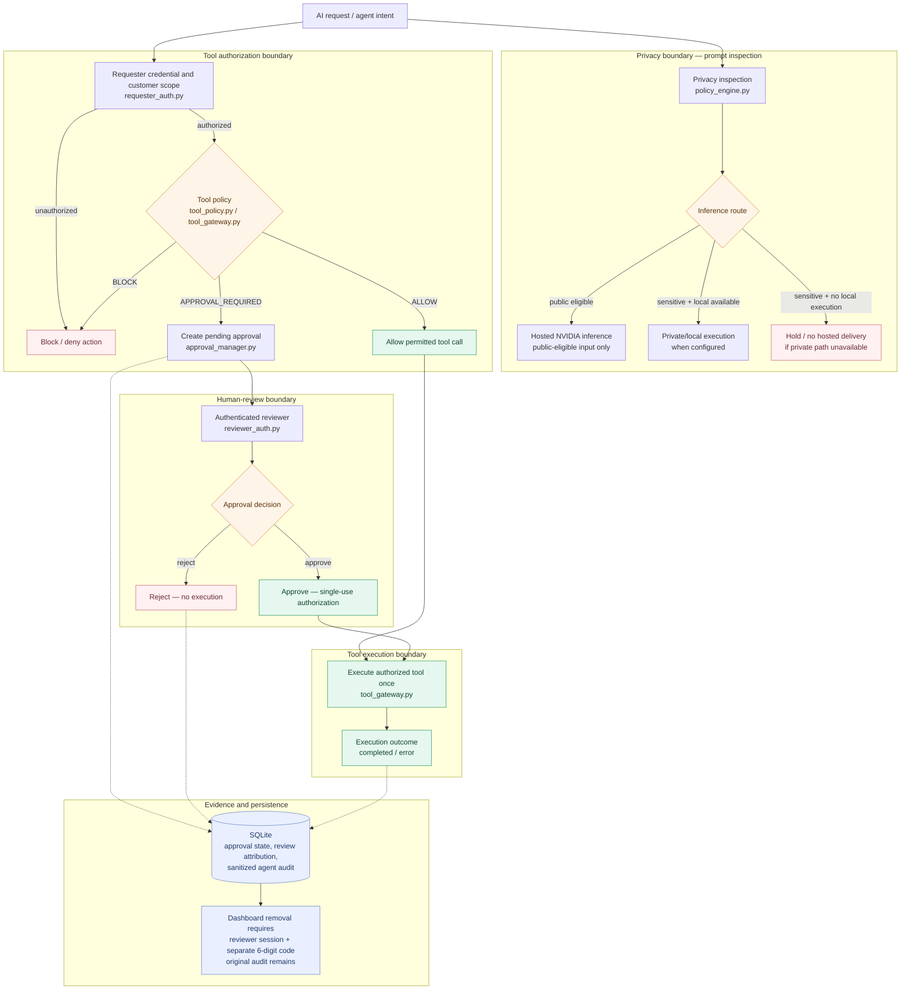

# AgentGate — Request Governance Architecture

AgentGate applies **two distinct controls**: privacy classification determines where model inference may occur, while requester authorization and tool policy determine whether an agent can use a company tool. Only actions requiring approval enter the human-review workflow.

## How to read the diagram

**Privacy routing is not tool authorization.** A prompt's eligibility for hosted inference does not grant access to company data or actions. Tool calls require authenticated requester identity and scoped permissions before policy enforcement. The decision branches into **ALLOW**, **BLOCK**, or **APPROVAL_REQUIRED**. Only the approval-required branch waits for a human decision; approval grants a single-use execution path.

**Blocked tool events may appear in in-memory operational telemetry; they are not represented as persisted approval records.**

**Audit evidence differs from the operational dashboard.** AgentGate stores approval decisions and sanitized agent execution metadata in SQLite. Removing a resolved approval from the dashboard requires an authenticated reviewer and a separate six-digit code; the removal is attributed and the original record is retained.

## Implementation traceability

| Architectural claim | Implementation | Verification |
|---|---|---|
| Privacy inspection and route selection | `policy_engine.py`, `engine.py`, `model_client.py` | Routing and privacy tests in `tests/` |
| Requester identity and customer scope | `requester_auth.py`, `console_server.py` | Authenticated tool endpoint tests |
| Allow / block / approval-required decisions | `tool_policy.py`, `tool_gateway.py` | Tool policy and approval tests |
| Reviewer decisions and single-use execution | `reviewer_auth.py`, `approval_manager.py`, `approval_store.py` | Approval lifecycle and HTTP workflow tests |
| Persisted, sanitized evidence | `approval_store.py`, `console_server.py` | SQLite store and audit tests |
| Protected operational removal | `reviewer_auth.py`, `console_server.py`, `approval_store.py` | `test_deletion_code.py`, `test_deletion_http.py` |

## Scope and limitations

This is a **localhost-first, single-reviewer prototype** using synthetic business records. Its privacy detection is pattern-based and not a guarantee against leakage. The private inference route requires an actually running, configured local model service. It is not an enterprise SSO implementation or a certified security boundary. Some routing and UI telemetry is in memory, while approval and sanitized agent records are persisted. Diagram arrows describe logical processing; they do not imply that all actions share one synchronous request path.
